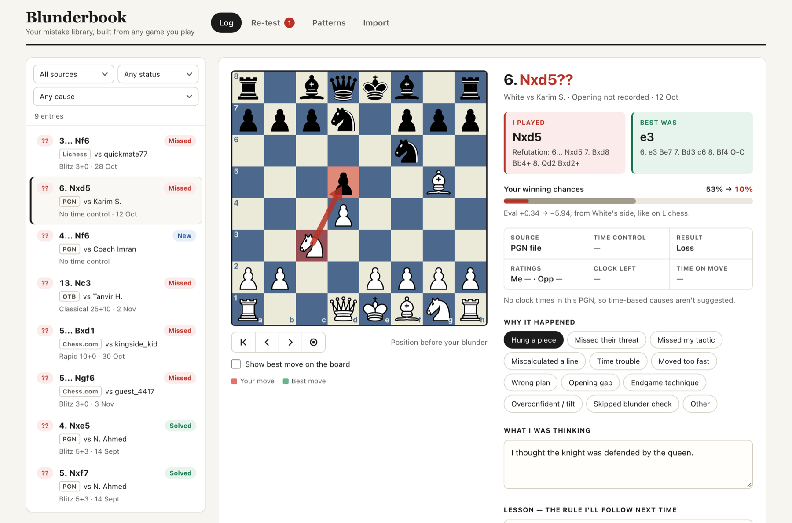
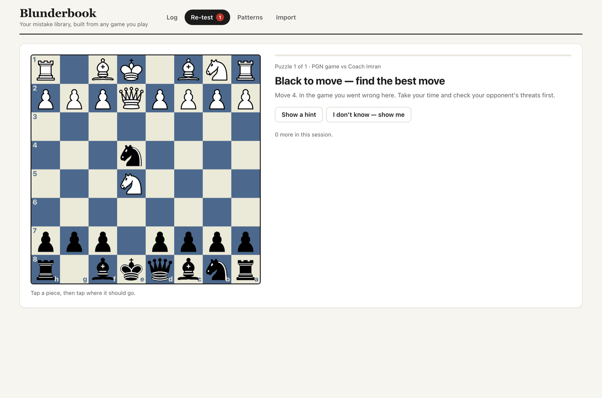
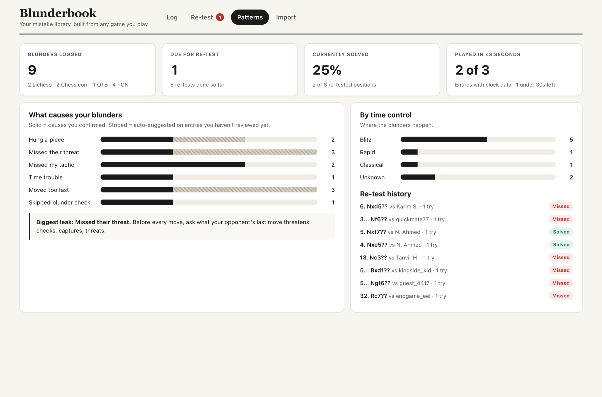

# Blunderbook

**A private, local-first chess mistake library.** Blunderbook imports your games, has
Stockfish find your blunders, fills in everything a machine can, and then re-tests you on
those positions until you stop making the same mistakes.



## Why it exists

Many club players keep a **blunder log**: a notebook or a printed A4 sheet with one page per
serious mistake. Each page holds a diagram of the position, the move you played, the move you
should have played, why it happened, what you were thinking and the lesson. Going back over
those pages is one of the most reliable ways to stop repeating the same mistakes.

Keeping it by hand is slow, though. You have to find the mistakes, copy the position, look up
the engine's line, note the clock and fill in the game's details before you get to the part
that helps: thinking about why it happened.

Blunderbook keeps that diary for you:

- **It does the mechanical work.** It finds your blunders with Stockfish and records the
  position, the best move and line, the refutation, the evals, the clock and the game's
  details. It also suggests likely causes.
- **The reflection stays yours.** "What I was thinking" and "Lesson" are always written by
  you, and a suggested cause counts only once you confirm it.
- **It brings the positions back.** A spaced-repetition re-test shows each position again
  until you find the right move.
- **It shows your patterns.** Which causes cost you the most, at which time controls.
- **It still prints.** Your entries print as A4 pages laid out like the paper log, two per
  page.

Everything stays on your computer: one SQLite file, no account, no cloud, no tracking.

## Contents

- [Features](#features)
- [Quick start](#quick-start)
- [Install](#install)
- [Using Blunderbook](#using-blunderbook)
- [How blunders are judged](#how-blunders-are-judged)
- [Configuration](#configuration)
- [Command reference](#command-reference)
- [Troubleshooting](#troubleshooting)
- [Privacy](#privacy)
- [Development](#development)

## Features

| | |
|---|---|
| **Import any game** | PGN files from Lichess, Chess.com or ChessBase, tournament downloads, and over-the-board games you typed up. One file can hold many games. |
| **Sync from Lichess and Chess.com** | `blunderbook sync` downloads your new games and imports them. |
| **One position, no PGN** | Log a single position from its FEN and the move you played. |
| **Same judgement everywhere** | Every game gets its own Stockfish analysis, whatever the source, so a blunder means the same thing in every entry. |
| **Suggested causes** | Time trouble, moving too fast, a missed threat or a hung piece are suggested from the clock and the engine's line. You confirm them. |
| **Re-test** | Each blunder comes back as a puzzle on a schedule: 1, 3, 7, 14, 30, then 60 days after each correct answer. |
| **Patterns** | Your most common causes, blunders by time control, and your re-test history. |
| **Print** | An A4 page per two entries, black and white, like the paper log. |
| **Backups** | Daily automatic backups, to a folder your cloud drive syncs if you like. |
| **AI explanations (optional)** | Off unless you turn it on. With your own OpenRouter key, a button explains a blunder in plain words from Stockfish's lines. |





## Quick start

With [uv](https://docs.astral.sh/uv/) and Stockfish installed (see [Install](#install)):

```sh
git clone https://github.com/ririyad/blunderbook.git
cd blunderbook
uv tool install .                  # puts the blunderbook command on your PATH

blunderbook init                   # your names, Stockfish, the backup folder
blunderbook import my-games.pgn    # find your blunders
blunderbook serve --open           # open the web app in your browser
```

Then, in the browser, open an entry, confirm why it happened and write your lesson. Practise
on the **Re-test** tab.

## Install

You need:

- **[uv](https://docs.astral.sh/uv/)** 0.13.7 or newer. It downloads Python 3.15 for you.
- **Stockfish 17 or newer.** Older versions work, with a warning.

### 1. Blunderbook

```sh
git clone https://github.com/ririyad/blunderbook.git
cd blunderbook
uv tool install .
```

If uv says its tool folder isn't on your `PATH`, run `uv tool update-shell` and open a new
terminal. To update later, `git pull`, then run `uv tool install --reinstall .`.

To run it without installing, use `uv sync` once, then `uv run blunderbook ...` from this
folder.

### 2. Stockfish

<details open>
<summary><b>macOS</b></summary>

Homebrew is the easiest way:

```sh
brew install stockfish      # on PATH, so there's nothing to set
```

Or download the macOS archive from [stockfishchess.org/download](https://stockfishchess.org/download/)
and unpack it. macOS blocks programs downloaded from the internet that Apple hasn't checked,
so allow this one, then tell Blunderbook where it is:

```sh
xattr -d com.apple.quarantine ~/Downloads/stockfish/stockfish-macos-universal
blunderbook engine set ~/Downloads/stockfish
```

You can also allow it in System Settings > Privacy & Security: click **Open Anyway** after
macOS has refused it once.
</details>

<details>
<summary><b>Windows</b></summary>

Download the Windows x86-64 zip from [stockfishchess.org/download](https://stockfishchess.org/download/)
(ARM64 for a Snapdragon PC), unzip it somewhere it can stay, and point Blunderbook at the
folder:

```powershell
blunderbook engine set "C:\Users\you\Tools\stockfish"
```

winget also has it: `winget install --id Stockfish.Stockfish -e`. If `blunderbook engine show`
doesn't find it afterwards, run `engine set` with the program's path.
<!-- TODO(verify): the winget version, and whether it puts `stockfish` on PATH. -->
</details>

<details>
<summary><b>Linux</b></summary>

Download the x86-64 (or ARM64) archive from [stockfishchess.org/download](https://stockfishchess.org/download/), then:

```sh
tar -xf stockfish-*.tar* -C ~/.local/share      # unpacks to a stockfish folder
blunderbook engine set ~/.local/share/stockfish
```

Your distribution's package (`sudo apt install stockfish`, `sudo dnf install stockfish`) works
too, but it's often older than 17.
</details>

`engine set` accepts the program itself or the folder you unpacked. It checks that the program
really is Stockfish before it saves anything.

```sh
blunderbook engine show     # which Stockfish is used, its version, and where the setting came from
blunderbook engine clear    # forget the saved path and look on PATH again
```

### 3. Set up

```sh
blunderbook init
```

`init` asks for:
- the names and usernames you play under, so it can tell which side you were;
- the Stockfish path (press Enter to use the one on `PATH`);
- a backup folder;
- your Lichess and Chess.com usernames, if you want to sync.

Press Enter at any question to keep its default. Run `blunderbook doctor` any time to check
that everything is in order.

## Using Blunderbook

### Import a PGN file

```sh
blunderbook import games.pgn
```

```text
Analysing with Stockfish 19 at depth 14.

Game 1 · Rashed vs Karim S. · 2026-10-12 · PGN file · you played White
  No clock times in this PGN.
  6. Nxd5??  Best was e3: 6. e3 Be7 7. Bd3 O-O 8. h3 b6
      Refutation: 6... Nxd5 7. Bxd8 Bb4+ 8. Qd2 Bxd2+
      Swing 0.41 · entry #1

Game 2 · Rashed vs Tanvir H. · 2026-11-02 · Over the board · Dhaka Chess Club · you played White
  No clock times in this PGN.
  13. Nc3??  Best was h3: 13. h3 Ne2+ 14. Qxe2 Bxe2 15. Ne6 Bb6
      Refutation: 13... Nf3+ 14. gxf3 Bxf3 15. Bf7+ Kxd8
      Swing 0.47 · entry #2
      Suggested: Missed their threat

Game 3 · guest_4417 vs rashed_blitz · 2026-11-03 · Chess.com
  Which side were you? Run again with --side white or --side black,
  or add your name to my_names in config.toml.

3 games read · 1 needs side · 2 blunders added
```

- **Your side** is found by matching the `White` and `Black` names against `my_names` and your
  site usernames, ignoring case. A game that matches neither name, or both, is never guessed.
  Add the name to `my_names`, or give the side for those games:

  ```sh
  blunderbook import games.pgn --side black
  ```

  `--side` only fills in games that need a side. It never overrides a name that matched.
- **Importing again is safe.** Games you already have are skipped, so the same file twice adds
  nothing:

  ```text
  3 games read · 2 skipped (duplicate) · 1 needs side · 0 blunders added
  ```

- **Any PGN works:** headers and clocks are optional. A bare move list, a game typed up from a
  score sheet, or a file from ChessBase in the old Windows encoding all import. What's missing
  shows as "—", and features that need it (such as the time-trouble hint) are skipped.
- **Standard chess only.** Chess960 and other variants are reported and skipped. One bad game
  never stops the rest of the file.
- **Depth:** `--depth 20` analyses deeper than `engine_depth` for this import. It's slower.

### Log a single position

For a game you have no PGN of, log the position before your move and the move you played:

```sh
blunderbook fen "3r2k1/4qppp/8/8/8/1Q6/5PPP/2R3K1 w - - 0 32" --move Rc7 --opponent endgame_eel --date 2026-11-01
```

```text
FEN entry · Rashed vs endgame_eel · 2026-11-01 · you played White
  32. Rc7??  Best was Qc4: 32. Qc4 g5 33. h4 Qf6 34. g3 Rd6
      Refutation: 32... Qe1#
      Swing 0.51 · entry #4
      Suggested: Missed their threat

Logged 32. Rc7?? as a blunder: entry #4.
```

You're the side to move. The move can be SAN (`Rc7`) or UCI (`c1c7`), and the date defaults to
today. A FEN entry is logged even if it's only a mistake (`?`) or an inaccuracy (`?!`). If
your move was the engine's own choice, or lost almost nothing, there's nothing to re-test, so
it isn't logged.

### Sync from Lichess and Chess.com

Put your usernames in config.toml (`init` asks for them), then:

```sh
blunderbook sync             # every site with a username
blunderbook sync lichess     # one site
```

```toml
[lichess]
username = 'your_lichess_name'
token = ''                   # optional: a personal API token downloads faster

[chesscom]
username = 'your_chesscom_name'
contact = 'you@example.com'  # required: Chess.com asks API users to say who they are
```

- Each sync downloads only the games played since the last good sync, then imports them like
  `blunderbook import`. **The first sync downloads your whole history**, which can take a
  while to analyse. You can stop it with Ctrl+C: the games analysed so far are kept, and the
  next run skips them.
- A failed sync changes nothing you already have and says what went wrong.
- Your Lichess token is only sent to Lichess. It never appears in the output or the database.

### The web app

```sh
blunderbook serve            # then open http://127.0.0.1:8732/
blunderbook serve --open     # the same, and opens your browser
blunderbook serve --port 8733
```

It runs on this computer only, at `127.0.0.1`. Nothing else on your network can reach it, and
the page loads nothing from the internet. Stop it with Ctrl+C.

- **Log** lists your entries, newest first, with filters for source, status and cause.
  Opening an entry shows:
  - the position before your move, with your move and (if you like) the best move as arrows,
    and step controls to go through the whole game;
  - what you played and the refutation, the best move and its line, and your winning chances
    before and after;
  - the game's details: source, time control, result, ratings, clock left and time on the
    move;
  - the cause chips (dashed ones are suggestions: click one to confirm it), and **What I was
    thinking** and **Lesson**, which save as you type;
  - with [AI explanations](#ai-explanations-optional) on, an **Explain this blunder** button;
  - **See the whole game**, which opens it on the Games tab.
- **Games** lists every game you imported, clean ones too. By default they're grouped by the
  import they came from (the file's name, "Pasted PGN", "Lichess sync"), newest first; **By
  date** shows one list instead. Filter by source, result (from your side), time control, with
  or without blunders, or search the opponent and opening. Each row shows the result, your
  side, the opponent, your marks (`2?? 1?`) or "Clean", the time control, opening and date.
  Games imported before this tab existed are grouped by the day they were imported.
  Opening a game shows:
  - the board from your side, with step controls (and ← → Home End) through the whole game,
    and a button that jumps to your next mistake;
  - the move list, your mistakes in red with their marks;
  - the game's details and the import it came from;
  - your entries from that game, each linking to the Log.
- **Re-test** shows each position that's due, from your side. Tap a piece (dots show where it
  can go; tap it again to put it down), then a square.
  "Show a hint" lights up the square the best move starts from; "I don't know — show me" gives
  the answer. You then see the best line, what you played in the game, your lesson and when
  the position comes back.
- **Patterns** shows your totals, the causes behind your blunders (solid for confirmed,
  striped for suggested), blunders by time control, and your re-test history.
- **Import** takes a pasted PGN, a dropped or chosen `.pgn` file (up to 10 MB), or a FEN
  position, and shows each game's result with links to the new entries and to the game.
  "See these games in Games" opens the list. Games that need a side must be imported on the
  command line with `--side`.
- **Extensions** that are on and have a page get a tab of their own after these. If one can't
  be used, `serve` says why when it starts, and runs without it.

### AI explanations (optional)

Off unless you turn it on. With your own [OpenRouter](https://openrouter.ai) key and a model
you choose, the Log gets an **Explain this blunder** button. It turns the engine's lines into 3
or 4 plain sentences, such as which piece your move left hanging and what the best move does
instead. Your thinking and your lesson stay yours to write: the explanation sits in its own
box and never fills them in.

```sh
blunderbook ai set-key                 # paste your OpenRouter key (typed hidden)
blunderbook ai model MODEL_ID          # a model id from openrouter.ai/models
blunderbook ai on
blunderbook ai show                    # on or off, the model, and whether a key is set
blunderbook ai off                     # hides the button; keeps the key and what's saved
```

- **Nothing is sent until you press the button.** "What's sent" next to it shows the exact
  text first.
- **What's sent:** the position, your move, Stockfish's lines and evals, the clock, the
  opening, and facts Blunderbook works out from the board (each capture along a line, pieces
  left attacked, a mate threat). **Never** player names, ratings, dates, the PGN, or anything
  you wrote or confirmed.
- **Who sees it:** OpenRouter and the company running the model. Blunderbook asks OpenRouter
  to use only providers that don't collect your data. Some models then have no provider; the
  page says so, and another model will do.
- **The model only explains.** It's told to use only the lines it's given, but it can still
  get things wrong. The engine's lines in the I played / Best was boxes are what to trust.
- **Saved once.** The explanation is kept with the entry, so each one is paid for once.
  "Explain again" replaces it. After a re-test, the result shows it too, never before you've
  tried. An explanation costs a fraction of a cent on most models; check prices on
  openrouter.ai.

### Extensions

Extensions are separate packages that add to Blunderbook: a tab, commands, a database of
their own. They can read your Log but never change it. Install one with the app, then turn
it on:

```sh
uv tool install --reinstall . --with ./extensions/library
blunderbook ext enable library
```

`blunderbook ext list` shows what's installed and on; `blunderbook ext disable NAME` turns
one off and keeps its data.

**Library** (in progress) holds openings, traps and tactics to study and practise, 15 to
start with. Practise comes later. For now:

- **The Library tab** (restart `blunderbook serve` after turning it on) lists the entries
  as openings, traps and tactics. Open one to read its idea and step through its moves on a
  board facing the side you play. Its replies show what can come next: a sound one in
  green, one that loses in red. Press a reply to play it out on the board.
- `blunderbook library list` lists them.
- `blunderbook library check [FOLDER]` checks every entry: its fields, and that every line
  and every practise answer is a legal move. Each entry is a TOML file, described in
  [extensions/library/README.md](extensions/library/README.md).

### Print your Blunder Log

```sh
blunderbook print --out blunder-log.html            # every entry
blunderbook print --due --out due.html              # only the ones due for a re-test
blunderbook print --ids 3,12 --out two.html         # these entries, in this order
```

```text
Wrote 4 entries (2 pages) to blunder-log.html
Open it in your browser and print it on A4.
```

The page is one self-contained HTML file in black and white, two entries per A4 sheet. Each
entry has the board, the game's details, I played / Best was, the causes ticked, your notes
(or ruled lines to write on), and "Re-tested on ___ ☐ Solved ☐ Missed again".

### Backups

The database is backed up automatically once a day, before `import`, `fen`, `sync` and
`serve`, and always before an upgrade or a restore. By hand:

```sh
blunderbook backup                   # into the backup folder
blunderbook backup --to /Volumes/USB # a one-off copy somewhere else
blunderbook restore blunderbook-2026-11-05_081756Z.db
```

- Backups are named by their UTC time, like `blunderbook-2026-11-05_081756Z.db`, so the
  newest sorts last. The 14 newest are kept (`keep` in config.toml).
- **Off your computer:** point the backup folder at a folder your cloud drive syncs (for
  example `%OneDrive%\Blunderbook` or `~/Dropbox/Blunderbook`). The database itself always
  stays local.
- **Restore** checks the file first, shows what it holds and asks before replacing anything.
  It keeps a copy of your current database. Stop `blunderbook serve` first. A file name on its
  own is looked up in the backup folder.
- **Extensions** that keep data (see `blunderbook ext list`) have their own database,
  backed up with yours as `<name>-…db`, for example `library-2026-11-05_081756Z.db`. Each
  name keeps its own 14. `restore` works out from the file name which database it replaces.
- **Settings aren't in backups.** config.toml, and your Lichess token and OpenRouter key in
  it, stay out of them. Saved AI explanations are in the database, so they are backed up.

### Moving to a new computer

1. Install Blunderbook and Stockfish.
2. Run `blunderbook init`. Give the same names, and the same backup folder if it's a synced
   one. Put your Lichess token back into config.toml by hand if you used one, and run
   `blunderbook ai set-key` again if you use AI explanations.
3. Restore the newest backup: `blunderbook restore <its file name>`. If your cloud drive keeps
   files online only, make it download that file first.

## How blunders are judged

Blunderbook judges your moves by how much of your **winning chance** they lose, rather than by
raw centipawns. A pawn dropped in a winning position matters less than one dropped in an equal
position.

1. Stockfish analyses every position of the game at `engine_depth` (16 by default).
2. Each eval becomes winning chances with the Lichess formula
   `w = 2 / (1 + exp(-0.00368208 × cp)) − 1`. A forced mate counts as ±10000 cp.
3. The **swing** of your move is how much your winning chances fell, from 0 to 1.
4. A move is logged when the swing reaches the blunder threshold and the move wasn't
   Stockfish's own choice:

   | Swing | Mark | Logged from imports |
   |---|---|---|
   | ≥ 0.15 | `??` blunder | yes |
   | ≥ 0.10 | `?` mistake | no (FEN entries only) |
   | ≥ 0.05 | `?!` inaccuracy | no (FEN entries only) |

5. For each logged position, Stockfish looks at its top three moves. Any move within
   `accept_margin_cp` (60 cp) of the best counts as a correct answer in the re-test.

The engine's version and depth are saved with every game. Evals already in a PGN (`[%eval]`)
are ignored, so every game is judged the same way.

**Suggested causes** come from the data, and stay suggestions until you confirm them:

| Suggestion | When |
|---|---|
| Time trouble | Less than 10% of the base time, or under 20 s, on your clock. |
| Moved too fast | 3 s or less on the move while you still had more than 30% of your time. |
| Missed their threat | After your move, the opponent has a forced mate. |
| Hung a piece | You're 3 or more points of material down (P 1, N/B 3, R 5, Q 9) after the engine's reply line. |

The time-based ones need clock times and a time control in the PGN. The full cause list is:
Hung a piece, Missed their threat, Missed my tactic, Miscalculated a line, Time trouble, Moved
too fast, Wrong plan, Opening gap, Endgame technique, Overconfident / tilt, Skipped blunder
check, Other.

**Re-test schedule:** a new entry is due the day it's logged. A correct answer brings it back
after 1, 3, 7, 14, 30, then 60 days. A miss, or giving up, brings it back tomorrow and starts
the run again.

## Configuration

All settings live in one file, `config.toml`, which `init` creates. There's no settings page in
the web app.

| | macOS | Windows | Linux |
|---|---|---|---|
| Settings | `~/Library/Application Support/blunderbook/config.toml` | `%LOCALAPPDATA%\blunderbook\config.toml` | `~/.config/blunderbook/config.toml` |
| Database | `~/Library/Application Support/blunderbook/blunderbook.db` | `%LOCALAPPDATA%\blunderbook\blunderbook.db` | `~/.local/share/blunderbook/blunderbook.db` |

Backups go to a `backups` folder next to the database unless you choose another folder.
`blunderbook doctor` prints the exact paths on your computer.

```toml
# Names and usernames used to work out which side you played.
my_names = ['Rashed', 'rashed_blitz']

# The Stockfish program, or empty to look for `stockfish` on PATH.
stockfish_path = ''

# First-pass search depth per position, and engine threads and hash.
engine_depth = 16
engine_threads = 2
engine_hash_mb = 128

# Swing thresholds, 0 to 1. Imports only log moves at or above `blunder`.
# Re-tests accept moves within accept_margin_cp centipawns of the best move.
[thresholds]
inaccuracy = 0.05
mistake = 0.1
blunder = 0.15
accept_margin_cp = 60

[lichess]
username = ''
token = ''          # optional personal token; never share this file

[chesscom]
username = ''
contact = ''        # sent in the User-Agent header, as Chess.com asks

[backup]
dir = ''            # empty = the local backups folder; may be a synced folder
keep = 14           # how many of the newest backups to keep
auto = true         # back up once a day before import, fen, sync and serve

[ai]
enabled = false     # set with: blunderbook ai on / off
model = ''          # an OpenRouter model id: blunderbook ai model NAME
key = ''            # your OpenRouter key: blunderbook ai set-key; never share this file
```

Blunderbook rewrites this file when a command changes a setting, so comments you add aren't
kept. Paths may use `~` and environment variables, and a relative path is relative to the
settings folder.

**Which Stockfish is used.** The first of these that's set wins:
1. `--stockfish PATH` on the command;
2. the `BLUNDERBOOK_STOCKFISH` environment variable;
3. `stockfish_path` in config.toml;
4. `stockfish` on `PATH`.

If one of them is set but broken, you get an error naming it. Blunderbook never quietly falls
back to the next one.

## Command reference

| Command | What it does |
|---|---|
| `blunderbook init` | Create config.toml and the database; asks for your names, Stockfish, the backup folder and site usernames. |
| `blunderbook doctor [--stockfish PATH]` | Check config, Stockfish, the database and the last backup. Changes nothing. |
| `blunderbook import FILE [--side white\|black] [--depth N] [--stockfish PATH]` | Import a PGN file and log your blunders. |
| `blunderbook fen "FEN" --move MOVE [--opponent NAME] [--date YYYY-MM-DD] [--stockfish PATH]` | Log one position and the move you played. |
| `blunderbook sync [lichess\|chesscom\|all]` | Download your new games, then import them. |
| `blunderbook serve [--port 8732] [--open]` | Start the web app on `127.0.0.1`. |
| `blunderbook print --out FILE.html [--ids 1,2] [--due]` | Write the A4 print page. |
| `blunderbook backup [--to FOLDER]` | Back up the database, and each extension's, now. |
| `blunderbook restore FILE [--yes]` | Replace the database (or an extension's) with a backup, after checking it. |
| `blunderbook engine show` | Show which Stockfish is used and where that setting came from. |
| `blunderbook engine set PATH` | Check a Stockfish program (or its folder) and save it. |
| `blunderbook engine clear` | Forget the saved path and look on `PATH` again. |
| `blunderbook ai show` | Show whether AI explanations are on, the model, and whether a key is set. |
| `blunderbook ai set-key` | Save your OpenRouter key, typed hidden. Empty removes it. |
| `blunderbook ai model NAME` | Save the model that writes explanations. |
| `blunderbook ai on` / `off` | Show or hide the "Explain this blunder" button. |
| `blunderbook ext list` | Show installed extensions and which are on. |
| `blunderbook ext enable NAME` / `disable NAME` | Turn an extension on or off; restart `serve` to see it. Turning one off keeps its data. |
| `blunderbook library list` | List the Library's entries (with the Library on). |
| `blunderbook library check [FOLDER]` | Check the Library's entries, or a folder of your own. |

Run `blunderbook COMMAND --help` for details. Every command ends with a one-line summary.
`import` and `sync` exit with 1 only when they can't run at all, not because some games
needed a side.

## Troubleshooting

**"macOS blocked it"** when Blunderbook starts Stockfish: the file came from the internet and
macOS stopped it. The message shows the three fixes: `brew install stockfish`, the `xattr`
command, or **Open Anyway** in System Settings > Privacy & Security.

**"Which side were you?"**: none of your names matched the game's players (or both did). Add
the name to `my_names`, or run `blunderbook import FILE --side white` (or `black`).

**"Port 8732 is already in use"**: Blunderbook is probably running already. Use that window,
or `blunderbook serve --port 8733`.

**The page says "Can't reach Blunderbook"**: `blunderbook serve` has stopped. Start it again
and reload the page.

**"No provider for … is available that doesn't keep your data"**: that model is only served by
providers that may keep requests. Pick another with `blunderbook ai model NAME`.

**Something else**: `blunderbook doctor` checks the setup and says what's wrong.

## Privacy

- Your games, notes and statistics live in one SQLite file on your computer.
- There are no accounts and no telemetry. The web app only answers on `127.0.0.1` and loads
  nothing from the internet.
- Blunderbook goes online only when you run `blunderbook sync`, and then only to Lichess and
  Chess.com, or when you press "Explain this blunder" with AI explanations on, and then only
  to OpenRouter, with the position and the engine's lines (see
  [AI explanations](#ai-explanations-optional)).
- Backups are local files. They leave your computer only if you put the backup folder inside
  a folder your cloud drive syncs.

## Development

```sh
uv sync                                        # install dependencies (and the extensions) into .venv
uv run pytest                                  # all tests, the extensions' too; engine tests skip without Stockfish
uv run pytest -m engine                        # only the tests that run Stockfish
uv run ruff check . && uv run ruff format --check .
uv run mypy                                    # strict on blunderbook/core
```

- **Stack:** Python 3.15, FastAPI, SQLite (no ORM), python-chess, Typer and httpx.
- **Frontend:** plain HTML, CSS and JavaScript modules, with no build step and no frontend
  dependencies.
- **Tests:** they never call Lichess or Chess.com; sync tests use recorded responses in
  `tests/fixtures/http/`.
- **Extensions** live in `extensions/<name>/`, each its own package in a uv workspace, with its
  own tests in `extensions/<name>/tests/`.

Read these before changing anything:
- [CLAUDE.md](CLAUDE.md) is the full specification: product rules, data model, analysis rules
  and API.
- [docs/ROADMAP.md](docs/ROADMAP.md) records how v1 was built and the decisions behind it.
- [docs/reference-demo.html](docs/reference-demo.html) is the original UI prototype.

## Licence

Blunderbook is free software under the [GNU General Public License v3.0](LICENSE) or (at
your option) any later version.
